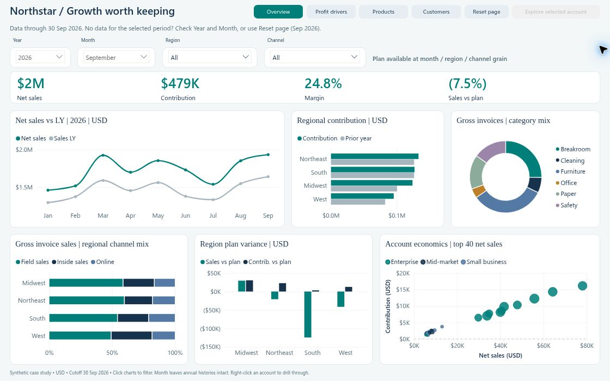
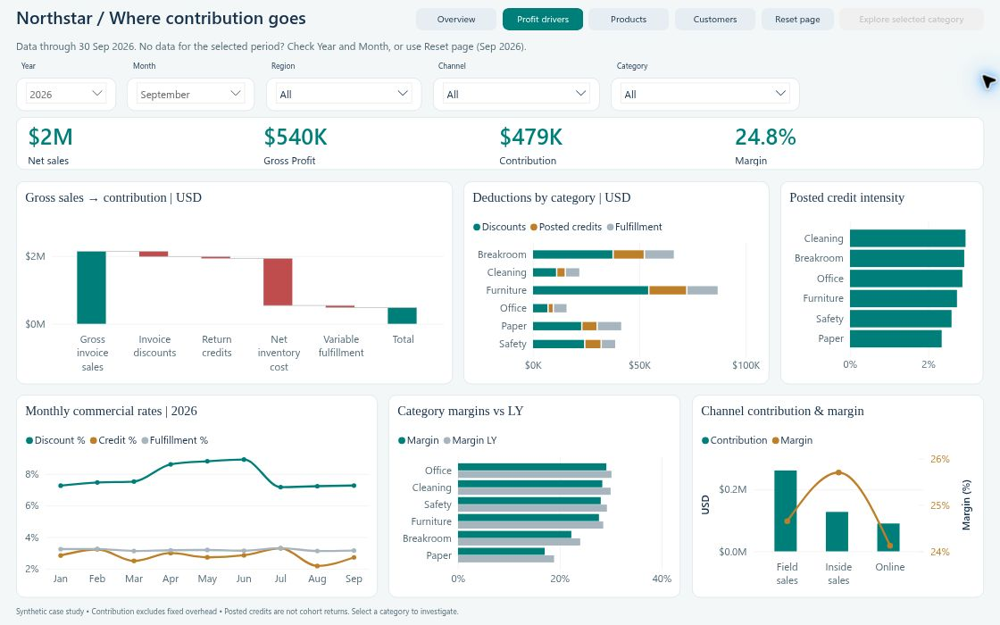
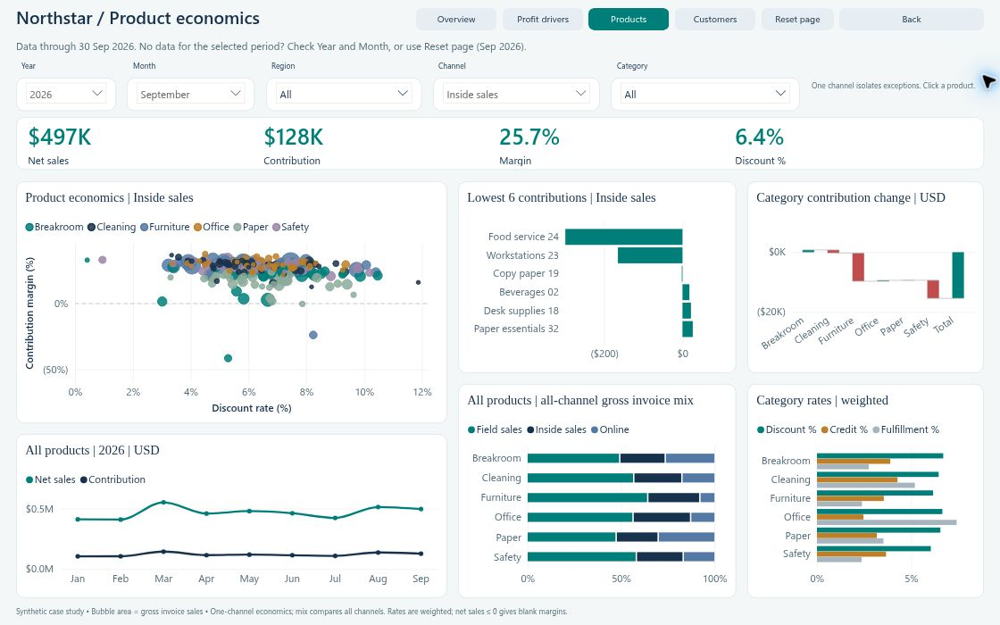
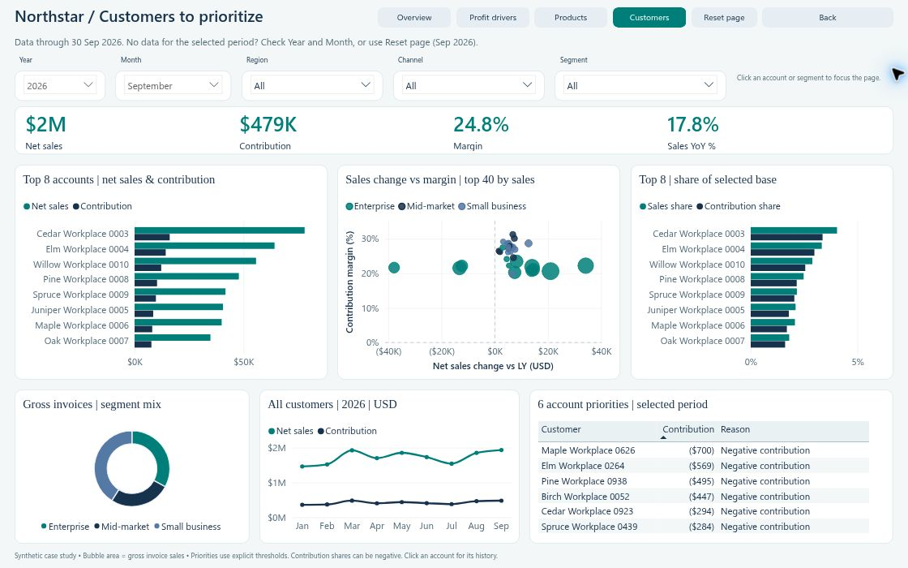

# Northstar Workplace Supply | Commercial Performance

A four-page Power BI case study exploring a practical question: **is sales growth translating into worthwhile contribution, and where should a commercial team investigate next?**

Northstar Workplace Supply is a fictional office and facility products distributor. This project uses synthetic transactions, customers, products and targets. The findings demonstrate analytical techniques; they do not represent real client results or business improvements delivered.

**At a glance:** 165,123 posted invoice/credit lines · 1,000 customers · 240 products · 4 regions · 3 channels · 4 report pages · 23 analytical charts.

**Stack:** Power BI Desktop, Power Query M, DAX, PBIP/PBIR, TMDL, Python and CSV. SQL Server staging/validation scripts are included as an optional, separately unverified path.

[Open the interactive Power BI report](https://app.powerbi.com/view?r=eyJrIjoiOWE1NWQwMjUtYzhiNS00YjM4LTgzZGUtZjg2MTRmNGVmMzdkIiwidCI6IjhiYmMwZjRiLTVkNWItNGNiMy05ZWM5LTc1MTc0MjRmMzY0ZiJ9) · [Open the editable project](commercial/NorthstarCommercial.pbip)

## Business questions

- Is growth improving contribution, or being offset by discounts, credits and fulfillment costs?
- Which regions and channels differ most from the prior year and the available monthly plan?
- Which products have weak economics within a particular sales channel?
- How concentrated are sales, and which customer accounts merit a closer review?

The intended audience is a commercial director and finance partner. The report moves from an overall performance review to product and account investigation rather than presenting a single undifferentiated dashboard.

## Report pages

| Page | Decision supported | Main views |
|---|---|---|
| **Commercial overview** | Where should the review begin? | Sales versus prior year, regional contribution and plan variance, category/channel mix, and account economics |
| **Profit drivers** | Where does invoice value go before becoming contribution? | Gross-sales-to-contribution waterfall, category deductions and margins, credit intensity, monthly commercial rates, and channel contribution |
| **Product investigation** | Which product/channel combinations deserve attention? | Discount-versus-margin scatter, six lowest product contributions, category contribution change, annual history, weighted rates, and all-channel gross invoice mix |
| **Customer priorities** | Which accounts matter most, and why review them? | Top-eight accounts, selected-base concentration, sales-change-versus-margin scatter, segment mix, annual account history, and a six-account action table |

The layouts combine trends, comparisons, waterfalls, scatter plots and composition views. There are no treemaps or matrices; one compact detail table supports the account-review workflow.

## Selected findings

### Growth outpaced contribution

**Context:** 1 January–30 September 2026 versus the same dates in 2025; all regions, channels, products and customers; USD. The report's `Year = 2026`, `Month = All` view contains January–September only, because the data cutoff is 30 September 2026.

| Metric | Jan–Sep 2025 | Jan–Sep 2026 | Change |
|---|---:|---:|---:|
| Net sales | $13,180,170.89 | $15,504,939.93 | +17.64% |
| Contribution | $3,530,206.45 | $3,786,933.11 | +7.27% |
| Contribution margin | 26.78% | 24.42% | −2.36 percentage points |
| Distinct invoice documents | 12,165 | 15,024 | — |

Contribution increased, but more slowly than sales. This supports investigating commercial rates and product/channel economics; it does not establish a causal explanation by itself.

### Concentration is measured against the selected customer base

**Context:** September 2026, all regions/channels/products/customers. The eight highest-sales customers account for **20.8643% of net sales**. Their displayed shares use all selected customers as the denominator, rather than being normalized to 100% of the eight displayed accounts.

For example, fictional **Cedar Workplace 0003** has September net sales of **$78,064.54**, contribution of **$16,125.84**, and a **4.0408%** sales share in that context.

### A declining account can still contribute positively

**Context:** Alder Workplace 0001, January–September 2026 versus January–September 2025; all regions/channels/products. Sales fall **55.82%**, from **$552,850.26** to **$244,266.97**. Contribution remains positive at **$46,260.76**, compared with **$131,271.00** previously.

This is an account-review signal, not a churn prediction or a recommendation to stop serving the customer.

The growth and Alder references are recorded in [insights.json](commercial/qa/insights.json); September concentration and Cedar references are in [publication09_reference.json](commercial/qa/publication09_reference.json). Native testing additionally checks the model's calculations and selected visual-query contexts. Displayed chart/card values may be rounded; the amounts above use the underlying values.

## Data and model

### Scope and grain

- **Transaction period:** 1 January 2024–30 September 2026. Calendar years, USD, fixed reporting cutoff.
- **FactCommercialLine:** one posted invoice or credit-memo line. There are 159,051 invoice lines and 6,072 credit lines, across 45,613 invoices and 6,065 credit documents. These are posted documents, not a separate sales-order dataset.
- **FactMonthlyTarget:** one month-start × region × channel plan, with 396 rows. Plans are independently generated assumptions, not a formula derived from actual sales.
- **SourceDocument:** 51,678 document-level audit records for allocation reconciliation. This CSV is not imported into the semantic model.
- **Files/model:** 10 CSVs; nine CSV-backed model tables plus a calculated `_Measures` table. The model contains 77 authored measures, including presentation, ranking and eligibility helpers.

| Imported table | Rows | Purpose |
|---|---:|---|
| FactCommercialLine | 165,123 | Posted invoice/credit activity |
| FactMonthlyTarget | 396 | Monthly region/channel plans |
| DimDate | 1,461 | Complete 2023–2026 calendar |
| DimCustomer | 1,000 | Fictional customer attributes |
| DimProduct | 240 | Products, categories and subcategories |
| DimRegion | 4 | Sales regions |
| DimChannel | 3 | Field sales, Inside sales and Online |
| ModelInfo | 1 | Reporting metadata and cutoff |
| ContributionBridge | 5 | Ordered accounting-bridge steps |

### Relationships and preparation

Five dimensions filter transaction lines: Date, Product, Customer, Region and Channel. Date, Region and Channel also filter the monthly-target fact. All eight relationships are single-direction, one-to-many from dimension to fact. There is no fact-to-fact relationship. `ModelInfo` and `ContributionBridge` are disconnected support tables; original-invoice lineage is an audit key, not a self-relationship.

Power Query reads the CSVs through one required `DataFolder` parameter, with explicit UTF-8 parsing, promoted headers, column types and `en-US` culture. Source money is generated in integer cents and stored to two decimal places; model monetary columns use fixed decimal. The marked date table is used for time analysis, with automatic date/time disabled.

See [MODEL_GUIDE.md](commercial/MODEL_GUIDE.md), [data_dictionary.json](commercial/data_dictionary.json), and the [TMDL model definition](commercial/NorthstarCommercial.SemanticModel/definition).

## Metric design

```dax
Net Sales =
    [Gross Invoice Sales] - [Invoice Discounts] - [Return Credits]

Gross Profit =
    [Net Sales] - [Net COGS]

Contribution =
    [Gross Profit] - [Variable Fulfillment Cost]

Contribution Margin =
    IF([Net Sales] > 0, DIVIDE([Contribution], [Net Sales]))
```

Important interpretation choices:

- **Contribution is not net or operating profit.** It excludes fixed overhead, tax, financing and other operating costs.
- Rates use aggregated numerators and denominators, never averages of row-level percentages. Margin is blank when net sales are nonpositive.
- Credits use their posting dates and retain their original product/customer attribution. **Credit to Sales** is posted credits divided by gross invoice sales after discounts; it is not a sales-cohort return rate and can exceed 100%.
- Fulfillment costs are allocated once per document. Signed inventory recovery on credits is retained rather than treating every credit as a full cost reversal.
- Prior-year comparisons match the selected reporting dates, including defined calendar month-end mapping. A 2026 YTD selection is compared with January–September 2025, not full-year 2025. Missing or nonpositive prior values do not produce a misleading percentage-growth result.
- Targets appear only for complete months within the reporting horizon and supported region/channel filters. Product/customer selections and partial months return blank targets; there is no invented target allocation or proration.
- Customer priorities are transparent rules: negative contribution first; then sales of at least $25,000 with margin below 10%; then sales decline greater than 10% versus the matching prior period; otherwise Monitor. The six-account membership uses priority, contribution and customer-key tie-breaking; the table displays Contribution ascending and has no Total row.

## Explore the report

1. **Start on Commercial overview.** Reset selects September 2026. Set Month to All for the available 2026 year-to-date view. Year, Month and Region are shared controls; general Channel is shared where designed.
2. **Investigate an account.** Select one bubble in **Account economics | top 40 net sales**. In Desktop edit mode, Ctrl+click **Explore selected account** to open Customer priorities for that account. A category or region selection does not supply the required customer field.
3. **Investigate a category.** On Profit drivers, select a category bar and Ctrl+click **Explore selected category**. Product investigation has its own Channel control, defaulting to Inside sales after Reset. It does not inherit Profit's incidental Online selection. Its all-channel mix deliberately ignores that local Channel filter and measures gross invoice sales, not net sales.
4. **Read period and history together.** Month affects selected-period metrics; the annual-history charts retain the selected year's available reporting months. Shared Year/Month/Region state and the selected entity are intentional parts of the navigation flow.
5. **Use Back and Reset deliberately.** Back returns to the prior page; it does not reset filters. Reset restores defaults and authored sort order, clears intended entity/local selections, and can affect matching shared slicers on other pages.

If December remains selected when switching from 2025 to 2026, the selected period has no data. Clear Month or use Reset. The report explains the empty period rather than silently substituting another date.

## Open and refresh locally

The tested environment was **Power BI Desktop 2.156.951.0 on Windows**. A compatible Windows Desktop build is required; these are editable project files, not a standalone web dashboard. PBIP stores the report and semantic model as text-based project folders. [Microsoft PBIP documentation](https://learn.microsoft.com/en-us/power-bi/developer/projects/projects-overview)

1. Download/extract or clone this repository into a new folder. Keep `commercial/NorthstarCommercial.pbip`, `NorthstarCommercial.Report` and `NorthstarCommercial.SemanticModel` together.
2. Open `commercial/NorthstarCommercial.pbip` in Power BI Desktop.
3. In Power Query's **Manage Parameters**, set `DataFolder` to the actual Windows-visible `commercial/data` folder, for example `C:/Portfolio/Northstar/commercial/data`. Use a valid Windows drive or UNC path in a VM, not a macOS-only path. [Parameter documentation](https://learn.microsoft.com/en-us/power-query/power-query-query-parameters)
4. Apply the parameter and run **Home → Refresh**. Check the nine imported row counts above. The shipped placeholder is `C:/PowerBI_Portfolio/commercial/data`; it is not automatically relative to the project.
5. Set **Fit to page**, then verify the default September 2026 anchors: net sales **$1,931,898.41** and contribution **$479,436.27**.
6. Run the read-only smoke query described below before relying on a newly refreshed or edited copy.

Python/Node are not required merely to open the PBIP. Do not regenerate data over the reviewed copy. The historical data generator belongs in a separate working copy if reproduction is needed.

Local Desktop refresh does not establish scheduled refresh in the Power BI service. Future service refresh requires an accessible source and appropriate gateway/connection setup. [Microsoft refresh documentation](https://learn.microsoft.com/en-us/power-bi/connect-data/refresh-data)

## Validation

Validation separates source arithmetic, native model execution, and observed report behavior. This summary reflects the completed Commercial acceptance review on **15 October 2026**.

| Layer | Verified result |
|---|---|
| Source/data checks | Keys and relationships, credit lineage, quantity/cost limits, document allocations, deterministic CSV hashes, and monthly reference reconciliation |
| Native refresh | All nine imported table counts match the frozen source |
| Native smoke suite | **68 of 68 unique tests passed** |
| Full native comparison | **77 of 77 cases passed**, covering 77 measures and **9,319 result rows**, with zero comparison errors |
| Additional numerical checks | 24 checks of account amounts/shares, concentration denominators and Paper channel mix passed |
| Primary Desktop flows | Account/category drill-through, month inheritance, independent Product Channel, Back, Reset, and sort persistence after save/reopen passed |
| Captured layouts | All four pages reviewed in available-year and September states; all 23 charts, eight-account lists and six action-table rows fit in the tested viewport |

The independent comparator distinguishes blank from zero, checks exact keys/text/integers, and uses tolerances of $0.000001 for money and 0.000000001 for ratios. Cases include selected customer cohorts, ranking/ties, target guards, sparse/exact/wider dates, leap-day mapping, credits, negative values and empty periods. Expected constants were not changed to make native results pass.

### Repeat the numerical checks

- Open [publication09_native_smoke.dax](commercial/qa/publication09_native_smoke.dax) in DAX Query View and run it. All 68 returned rows must be PASS.
- For the larger suite, execute one named CASE at a time from [publication09_native_all_measures.dax](commercial/qa/publication09_native_all_measures.dax), then export raw, unrounded results. From the repository root, compare an export using Python 3.10+ (standard library only):

```bash
python tooling/audit_commercial_publication_09.py --case month_all_2026 --actual export.csv
```

Use the matching CASE identifier for each export. The comparison tool is read-only: it compares exports with frozen expected values and never rebuilds the reference constants. The query/reference filenames are retained so existing exported cases remain compatible.

### Validation boundaries

These results apply to the reviewed Desktop build, not every possible filter combination or viewport. The public report opens without sign-in and contains four pages. A bounded anonymous-reader smoke review verified all four published pages, channel changes, product and customer Reset, account drill-through, multi-month KPI changes with annual-history preservation, Enter-key navigation and sampled tooltips. No reproducible defect was found in those checks. This does not certify the public report against an exact source-file hash, mobile layouts, full keyboard accessibility or screen-reader behavior. Performance Analyzer measurements remain outside this review. SQL Server scripts have not been executed on SQL Server.

## Repository contents

The repository contains the Commercial project only:

```text
README.md
commercial/
  NorthstarCommercial.pbip
  NorthstarCommercial.Report/          # PBIR report and static resources
  NorthstarCommercial.SemanticModel/   # TMDL model and DAX definitions
  data/                               # 10 synthetic CSVs, including audit source
  MODEL_GUIDE.md
  data_dictionary.json
  metric_definitions.json
  manifest.json                       # frozen CSV identity and current model count
  build_commercial.py                  # historical data generator; separate copy only
  sql/                                # optional, unexecuted SQL Server path
  qa/
    insights.json
    publication09_native_smoke.dax
    publication09_native_all_measures.dax
    publication09_reference.json
    README.md
screenshots/                          # report-only September 2026 captures
requirements.txt
tooling/
  audit_commercial_publication_09.py   # read-only comparison tool
  verify_source.py                    # frozen CSV hash/count validation
```

Local caches, account metadata, workstation paths and raw execution logs are excluded. The bundled customer/product names, documents and row-level records are fictional, not anonymized real customer data.

No repository-wide reuse license is granted. All rights reserved, except where a third-party component has its own applicable terms.

## Screenshots

These are report-canvas captures of the published report in its September 2026 selection. All values and customer names are synthetic. Annual-history panels deliberately retain the available months of the selected year.

### Commercial overview

September 2026, all regions and channels: $1,931,898.41 net sales, $479,436.27 contribution and approximately 24.8% contribution margin. Cards use rounded display values.



### Profit drivers

September 2026, all regions, channels and categories: reconcile gross invoice sales to contribution and compare deductions, credit intensity and channel economics.



### Product investigation

September 2026, Inside sales, all regions and categories: examine product contributions, discounts and margins. The all-channel gross invoice mix intentionally spans every channel.



### Customer priorities

September 2026, all customers, segments, regions and channels: compare account scale, selected-base concentration and transparent review priorities. Negative contribution remains visible.



## Synthetic-data generation

AI assistance was used for synthetic-data generation. The delivered CSVs were produced by a reproducible Python generator with fixed seeds, a fixed cutoff and explicit accounting rules, then independently checked. Transaction seed: `20260930`; independent plan seed: `481516`.

The data intentionally contains differences in product/channel economics, customer concentration, return-credit patterns and account trends to support investigation. These designed patterns are examples, not evidence about real firms or a basis for causal claims.
